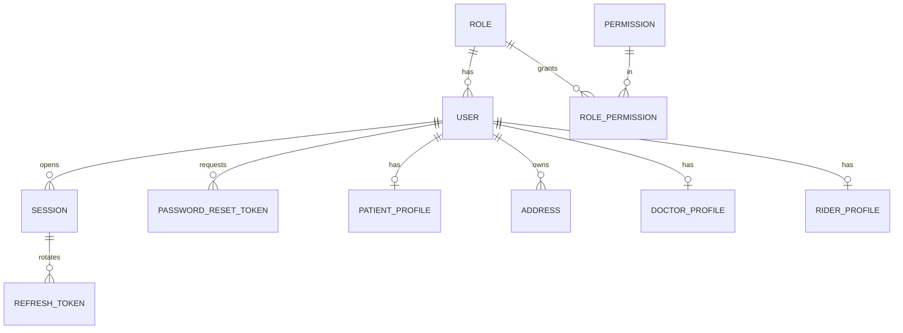
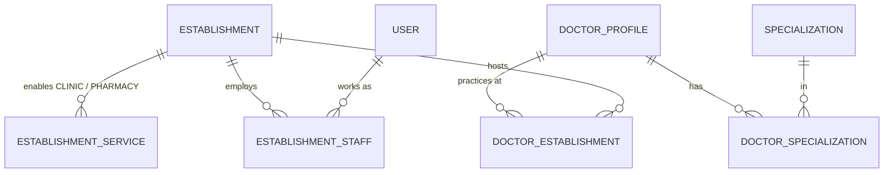
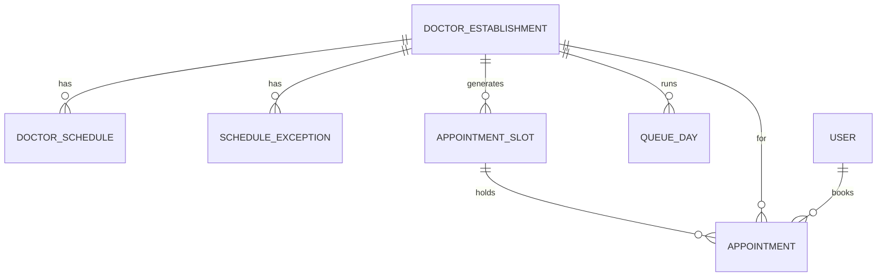
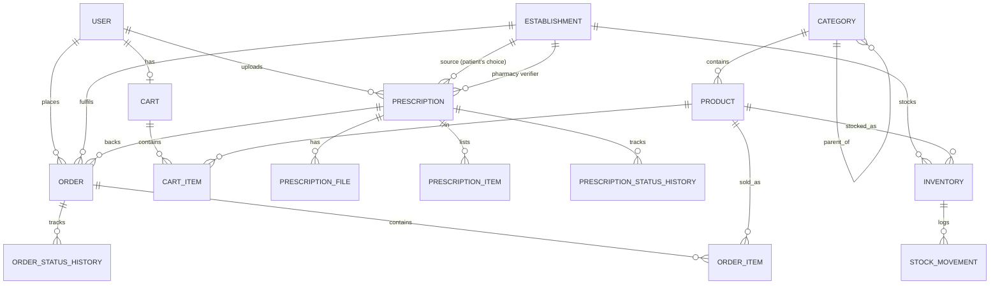
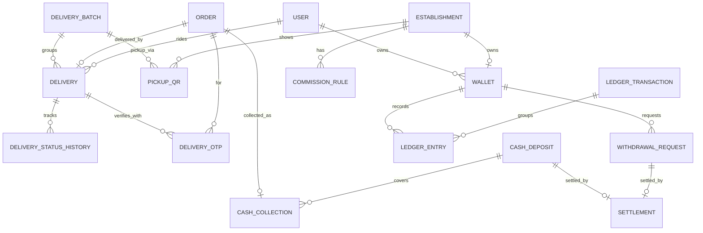
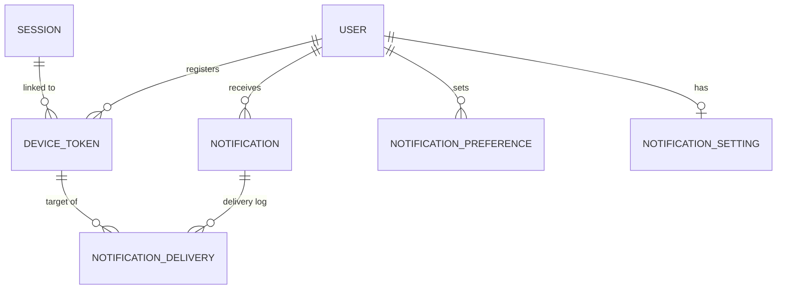
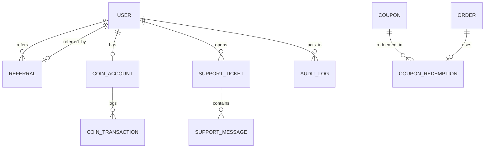

# Oshud Wala - Entity Relationship Diagram (design v2)

Rendered by any Mermaid viewer (GitHub, VS Code Mermaid extension). Only keys and relationships are shown; full columns are in `prisma/schema.prisma` (64 models, 42 enums). Clinic and Pharmacy are one `ESTABLISHMENT`.

## 1. Identity and access

## 2. Unified establishment, staff, doctors

## 3. Clinic service: schedule, appointments, queue

## 4. Pharmacy service: catalog, stock, prescriptions, cart, orders

## 5. Delivery, cash, wallet, ledger

## 6. Notifications

`outbox_events` (standalone) feeds notifications and holds scheduled reminders.

## 7. Growth, support, platform

Standalone tables: `idempotency_keys`, `outbox_events`, `platform_settings`.
