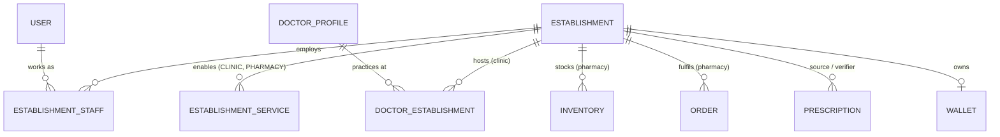

# Unified Establishment (Clinic and/or Pharmacy) - Design v2

Status: DESIGN ONLY, awaiting approval.

## 1. Principle
One business = one `Establishment` row, identified by one `establishmentId`. Everything the business does links to that id. A service switch decides what it offers:

| Service | Enables |
|---|---|
| `CLINIC` | doctors, schedules, appointments, receptionists, live queue |
| `PHARMACY` | pharmacists, inventory, prescription verification, medicine orders, pickup QR |
| Both | all of the above under one profile, one admin team, one dashboard |

Never create a second establishment for the same business; enable the other service.

## 2. Data model


| Concern | Where it lives |
|---|---|
| Shared: name, legal name, business reg. no., phone, email, address, geo, timezone, opening hours, logo, shared settings, status, approval, wallet, admins | `establishments` |
| Service-specific: status, licence number and expiry, accepting-requests pause, settings JSON | `establishment_services` (one row per service) |
| Who works there and in what function | `establishment_staff` (`ADMIN`, `RECEPTIONIST`, `PHARMACIST`) |
| Doctors (global profile, per-establishment fee) | `doctor_establishments` |

Example service settings (validated by Zod per service type):
- CLINIC: `{ "requireClinicReview": true, "bookingWindowDays": 30, "cancellationCutoffMinutes": 120 }`
- PHARMACY: `{ "prepTimeMinutes": 30, "deliveryRadiusKm": 8, "autoRejectAfterMinutes": 30 }`

## 3. Registration and lifecycle
One registration form and one endpoint set, not two.

1. **Apply**: `POST /api/v1/establishments/register` with business details, desired services (`CLINIC`, `PHARMACY` or both), a licence number per requested service, and the first admin's account details (creates a user with role `ESTABLISHMENT_ADMIN`). Result: establishment `PENDING`, each requested service `PENDING`. (Alternatively Super Admin creates it directly: `POST /api/v1/admin/establishments`.)
2. **Review**: Super Admin approves the establishment, then each service independently (`ACTIVE`) or rejects with a reason. A pharmacy licence can be rejected while the clinic service is approved.
3. **Operate**: staff use the one Admin Web Platform. The API returns `GET /me/establishments` with the enabled services; the UI shows only the matching sections. No duplicate dashboards.
4. **Change services later**: an admin may request a new service (goes `PENDING`, Super Admin approves). Disabling a service is blocked while non-final work exists (open appointments, unfinished orders or prescriptions); data is kept, never deleted.
5. **Suspend**: Super Admin can suspend the whole establishment or one service (blocks new bookings/orders; in-flight work can complete or be cancelled by Super Admin).

States: `Establishment.status`: PENDING, ACTIVE, SUSPENDED, CLOSED. `EstablishmentService.status`: PENDING, ACTIVE, SUSPENDED, DISABLED.

## 4. Access rules (enforced in services, not only routes)
A request touching establishment E, service S is allowed only if all hold:
1. The user's role has the permission (RBAC), e.g. `clinic.appointment:update`.
2. The user has an active `establishment_staff` row for E (or is Super Admin; doctors via an active `doctor_establishments` row).
3. The `staff_role` fits the service: RECEPTIONIST only CLINIC; PHARMACIST only PHARMACY; ADMIN both.
4. Service S is `ACTIVE` on E (otherwise `SERVICE_NOT_ENABLED`, HTTP 409).
5. For customer-facing actions: `isAcceptingRequests` is true.

The `User.role` must match `staffRole` (`ESTABLISHMENT_ADMIN`/`RECEPTIONIST`/`PHARMACIST`); one account has one role.

## 5. Where each existing feature lands
| Feature | Establishment link | Required service |
|---|---|---|
| Doctor linking, fee | `doctor_establishments.establishmentId` | CLINIC |
| Schedules, slots, appointments, tokens, queue | via `doctor_establishment_id` | CLINIC |
| Receptionist work | `establishment_staff` RECEPTIONIST | CLINIC |
| Pharmacist work | `establishment_staff` PHARMACIST | PHARMACY |
| Inventory and stock movements | `inventory.establishmentId` | PHARMACY |
| Orders, pickup QR | `orders.establishmentId`, `pickup_qrs.establishmentId` | PHARMACY |
| Prescription verification | `prescriptions.pharmacyEstablishmentId` | PHARMACY |
| Primary Pharmacy | `establishments.isPrimaryPharmacy` (at most one, partial unique index) | PHARMACY (ACTIVE) |
| Wallet and withdrawals | `wallets.establishmentId` (one wallet; ledger tags `serviceType`) | any |
| Commission | `commission_rules.establishmentId` + `target` (PHARMACY_ORDER or APPOINTMENT) | per target |

## 6. Prescription routing with unified establishments
1. Patient picks no establishment: goes to the Primary Pharmacy (`pharmacyEstablishmentId` = primary).
2. Patient picks establishment E:
   - E has an ACTIVE PHARMACY service: if `requireClinicReview` is set, a clinic-side review (admin or doctor) runs first (`CLINIC_REVIEW`), then `PHARMACY_VERIFYING` at E's own pharmacy. Otherwise straight to `PHARMACY_VERIFYING`.
   - E is clinic-only: after clinic review, Super Admin chooses the pharmacy (draft assumption, open question 4).
3. Status names are unchanged (`CLINIC_REVIEW` and `FORWARDED_TO_PHARMACY` now mean "clinic-service review" and "routed to a pharmacy service").

## 7. Integrity rules not expressible in Prisma (to be added as SQL or service checks)
- Partial unique index: at most one `isPrimaryPharmacy = true`.
- Setting primary requires an ACTIVE PHARMACY service (transaction check) and clearing primary on the old row in the same transaction.
- `doctor_establishments`, `inventory`, `orders`, `pickup_qrs` rows may only be created while the matching service is ACTIVE (service-layer check inside the same transaction; a nightly integrity job reports violations after a service is suspended).
- A user cannot hold two staff rows with different roles for the same establishment (unique `user_id + establishment_id`).

## 8. Planned API summary (all under `/api/v1`)
| Endpoint | Who |
|---|---|
| `POST /establishments/register` | applicant (becomes ESTABLISHMENT_ADMIN, PENDING) |
| `POST /admin/establishments` | Super Admin direct create |
| `GET /establishments`, `GET /establishments/:id` | public search; filter `service=CLINIC\|PHARMACY`, city, text |
| `GET /me/establishments` | any staff: my establishments and enabled services |
| `PATCH /establishments/:id` | Establishment Admin (own), Super Admin |
| `POST /admin/establishments/:id/approve`, `/suspend`, `/reactivate` | Super Admin |
| `PUT /establishments/:id/services/:type` | request/enable a service, update its settings and licence |
| `POST /admin/establishments/:id/services/:type/approve`, `/suspend`, `/disable` | Super Admin |
| `POST /establishments/:id/services/:type/pause`, `/resume` | Admin (toggle `isAcceptingRequests`) |
| `GET/POST /establishments/:id/staff`, `PATCH/DELETE .../staff/:staffId` | Admin, Super Admin |
| `PUT /admin/settings/primary-pharmacy` | Super Admin |

## 9. Modules after unification
`establishment` (new, replaces `clinic`, `clinicStaff`, `pharmacy`), plus existing `doctor`, `specialization`, `schedule`, `appointment`, `queue`, `receptionist`, `pharmacist`, `product`, `category`, `inventory`, `prescription`, `order`, etc. Total module folders: 34.

Folder change to apply with the Phase 4 patch (only if the folders are still empty):
```zsh
cd "/Users/soumyachatterjee/Vivek da/oshud-wala-backend/src/modules" && for m in clinic clinicStaff pharmacy; do if [ -z "$(find "$m" -type f -size +0c 2>/dev/null)" ]; then rm -r "$m" && echo "removed $m"; else echo "KEPT $m (has content)"; fi; done; mkdir -p establishment && for s in constants controller service repository routes validation; do [ -e "establishment/establishment.$s.ts" ] || touch "establishment/establishment.$s.ts"; done
```
