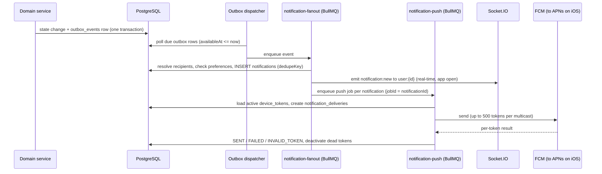

# Notification System - Design v2

Status: DESIGN ONLY, awaiting approval. Nothing here is implemented or tested.

## 1. Goals and honest limits
Goal: important events reach users even when the app is closed or in the background, every important event is stored, and failures are visible and retried.

- **Socket.IO** is used only for real-time updates while the app is open. It cannot reach a closed app.
- **Push (FCM, which forwards to APNs on iOS)** is the channel for closed or background apps.
- **PostgreSQL** stores every notification (history, read state) and every delivery attempt. It is the source of truth; Redis only queues work.

Limits that no backend can remove (to be stated honestly to stakeholders): FCM and APNs are best-effort; delivery can be delayed or dropped by phone battery optimisation, Do Not Disturb or Focus modes, revoked notification permission, uninstalled apps, or no network. FCM "success" means the message was accepted by Google, not that the phone displayed it. The design therefore (a) always stores the notification so the user sees it when they open the app, (b) tracks optional client acknowledgements, and (c) keeps the delivery OTP readable in-app regardless of push.

## 2. Pipeline

Key properties:
- The notification row and the event are committed in the **same transaction** as the business change, so "order accepted but nobody told" cannot happen.
- Creating a notification is **idempotent**: `UNIQUE (userId, dedupeKey)`; a retried job cannot send the same notification twice.
- A **sweeper** (maintenance queue, every minute) re-enqueues deliveries stuck `PENDING` longer than 2 minutes and outbox rows stuck unprocessed, so a Redis flush or worker crash loses nothing.
- Push is always attempted when enabled; the app de-duplicates by `notificationId` and shows an in-app banner instead of a system notification when foregrounded. (Presence-based suppression is deliberately avoided: stale presence would cause missed alerts.)

## 3. Tables (see `prisma/schema.prisma`)
| Table | Purpose |
|---|---|
| `notifications` | In-app store and history. Category, `eventType`, title, body, `data` (route and ids only), priority, `isSensitive`, `isMandatory`, `dedupeKey`, `readAt`, `expiresAt` |
| `notification_deliveries` | Delivery log per push target (per device token) and per socket emit: status, skip reason, provider message id, attempts, error code, `nextRetryAt`, `sentAt`, `ackedAt` |
| `device_tokens` | One row per app install: `deviceId`, FCM `token`, platform, app/OS version, `isActive`, `invalidReason`, `lastSeenAt`, linked `sessionId` |
| `notification_preferences` | Per category: push on/off, in-app on/off |
| `notification_settings` | Master push switch, quiet hours (NORMAL priority only), timezone |
| `outbox_events` | Transactional events and scheduled work (reminders via `availableAt`, `dedupeKey`, cancellable) |

## 4. Device tokens
- **Register**: after login (and when the user grants permission) the app calls `POST /devices` with `{ deviceId, token, platform, appVersion, osVersion, deviceModel, locale }`. Upsert by `(userId, deviceId)`.
- **Multiple devices**: one active row per install; all active rows receive the push.
- **Refresh**: FCM can rotate tokens. The app calls `PUT /devices/:deviceId` with the new token; the row's token is replaced.
- **Shared phone / account switch**: the token is globally unique. If another user registers the same token, it moves to that user (old owner's row deactivated with `REASSIGNED`). A device never receives a previous user's notifications.
- **Logout / session revoke / password change**: tokens linked to the session are deactivated (`LOGOUT`) so a logged-out phone stops receiving alerts. App also calls `DELETE /devices/:deviceId`.
- **Invalid-token cleanup**: FCM errors `registration-token-not-registered` and `invalid-registration-token` (plus invalid-argument on a token) deactivate the token immediately (`UNREGISTERED`/`INVALID`) and mark that delivery `INVALID_TOKEN`. A daily job deactivates tokens not seen for 60 days (`STALE`); apps re-register on every launch (updates `lastSeenAt`).
- Tokens are credentials: never logged in full (first 8 characters at most), never returned to other users.

## 5. Push payloads
Backend sends through the Firebase Admin SDK (FCM HTTP v1). iOS is reached **through FCM**: the Firebase project holds the APNs authentication key (.p8); the backend never talks to APNs directly. (Direct APNs can be added later behind the same `PushProvider` interface if ever needed.)

Each message contains a visible `notification` block (so the OS shows it when the app is killed) plus a small `data` block:
```
notification: { title, body }                         // generic text if isSensitive
data: { notificationId, category, eventType, route, entityType, entityId }   // strings only, no PII, no secrets
android: { priority: HIGH|NORMAL, ttl, notification: { channelId: <category>, tag/collapseKey for queue updates } }
apns:    { headers: { apns-priority: 10|5, apns-push-type: alert }, payload: { aps: { sound, thread-id: <entity>, mutable-content: 1 } } }
```
- Android channels per category (so users can tune them); HIGH priority for OTP alert, rider assignment, order status, queue "your turn".
- Collapsible updates (queue position) use a collapse key so only the latest is kept.
- Message `ttl` follows `expiresAt` (a "your turn" alert is useless after an hour).
- **Never in push or socket payloads**: the delivery OTP, QR tokens, passwords, prescription file URLs, medical details, wallet balances. Sensitive categories show generic text, for example "Your delivery update is ready. Open Oshud Wala to view it." The OTP value is readable only through `GET /orders/:id/delivery-otp` by the owning customer.

## 6. Queues and retries (BullMQ on Redis)
| Queue | Job | Attempts / backoff |
|---|---|---|
| `outbox` | dispatch due outbox rows | poll every few seconds; row-level `FOR UPDATE SKIP LOCKED` so several workers never double-process |
| `notification-fanout` | resolve recipients, write `notifications`, emit socket, enqueue push | 5, exponential from 2s |
| `notification-push` | send to a user's active tokens | 5, exponential from 5s with jitter |
| `maintenance` | sweeper, stale-token cleanup, expire notifications, purge old deliveries (retain 90 days) | cron |

Failure handling by error class:
| Error | Action |
|---|---|
| Token unregistered/invalid | deactivate token, no retry |
| `unavailable`, `internal`, `deadline-exceeded`, quota/rate exceeded | retry with backoff; honour `Retry-After` |
| Credentials/auth error, project misconfigured | do not burn retries; mark FAILED, raise an alert to Super Admin and logs (`notification.provider.down`) |
| Payload too large / invalid | FAILED, logged as a bug |
| Retries exhausted | delivery `FAILED`, kept for inspection; Super Admin can retry from the admin endpoint; the in-app notification still exists |

BullMQ `jobId = deliveryId` (and `notificationId` for fan-out) so duplicate enqueues collapse. Completed jobs are trimmed; failed jobs are kept 7 days.

## 7. Preferences and priorities
- Order of checks per recipient: master `pushEnabled` and category `pushEnabled` (skipped for `isMandatory`), then quiet hours (NORMAL priority only; delayed or skipped, HIGH and mandatory bypass), then active device tokens.
- **Mandatory (cannot be disabled)**: delivery OTP alert, security alerts (new login, password changed), withdrawal paid/rejected, order rejected/cancelled by the establishment.
- Disabling a category's `inAppEnabled` hides it from the list but never deletes security items.
- SKIPPED deliveries record the reason (`PREFERENCE_DISABLED`, `QUIET_HOURS`, `NO_ACTIVE_DEVICE`, `EXPIRED`).

## 8. Real-time (Socket.IO) and recovery
- On connect the server joins `user:{id}`; fan-out emits `notification:new` (id, category, title, body or generic text, route) and `notification:unread_count`.
- Sockets are an optimisation. After reconnect the app calls `GET /notifications?since=<timestamp>` and `GET /notifications/unread-count` to heal gaps.
- Socket delivery is logged as one `SOCKET` delivery row (`SENT` if a socket was connected, otherwise `SKIPPED/NO_SOCKET`).

## 9. Event catalog
Recipients are resolved server-side: `user` (a specific user), `staff(E, role)` (active staff of establishment E with a role), `role(SUPER_ADMIN)`. Priority H = high. M = mandatory. S = sensitive (generic push text). Templates live in code (`notification.events.ts`) and can be localised later.

| Event key | Category | Recipients | Pri | Flags |
|---|---|---|---|---|
| `appointment.confirmed` | APPOINTMENT | patient; doctor; staff(E, RECEPTIONIST) | H | |
| `appointment.cancelled` | APPOINTMENT | patient; doctor; staff(E, RECEPTIONIST) | H | |
| `appointment.rescheduled` | APPOINTMENT | patient; doctor | H | |
| `appointment.reminder_24h`, `.reminder_1h` | APPOINTMENT | patient | H | scheduled via outbox, voided on cancel |
| `queue.token_issued` | QUEUE | patient | N | |
| `queue.turn_soon` (N tokens ahead) | QUEUE | patient | H | collapse key, short ttl |
| `queue.your_turn` | QUEUE | patient | H | short ttl |
| `queue.paused` / `queue.closed` | QUEUE | waiting patients | N | |
| `prescription.received` | PRESCRIPTION | staff(E, PHARMACIST) | N | |
| `prescription.accepted` (verified) | PRESCRIPTION | patient | H | S |
| `prescription.rejected` | PRESCRIPTION | patient | H | S, M |
| `prescription.confirmation_required` | PRESCRIPTION | patient | H | S |
| `order.placed` | ORDER | staff(E, PHARMACIST); role(SUPER_ADMIN) | H | |
| `order.accepted` | ORDER | patient | H | |
| `order.confirmation_required` | ORDER | patient | H | |
| `order.preparing`, `order.ready_for_pickup` | ORDER | patient; role(SUPER_ADMIN) for ready | N / H | |
| `order.rejected`, `order.cancelled` | ORDER | patient; staff(E, PHARMACIST) | H | M |
| `delivery.rider_assigned` | DELIVERY | patient; rider (as `delivery.assigned`) | H | |
| `delivery.picked_up`, `delivery.shipped` | DELIVERY | patient; role(SUPER_ADMIN) | N | |
| `delivery.arrived_otp_ready` | DELIVERY | patient | H | **M, S** (never contains the code) |
| `delivery.delivered` | DELIVERY | patient; rider; role(SUPER_ADMIN) | H | |
| `delivery.failed` | DELIVERY | patient; role(SUPER_ADMIN) | H | M |
| `rider.assignment_new`, `rider.assignment_removed` | DELIVERY | rider | H | |
| `payment.cod_collected` | PAYMENT | patient (receipt); role(SUPER_ADMIN) | N | S |
| `wallet.credited`, `wallet.debited` | WALLET | wallet owner | N | S |
| `wallet.rider_earning_credited` | WALLET | rider | N | S |
| `withdrawal.requested` | WALLET | role(SUPER_ADMIN) | N | |
| `withdrawal.approved` | WALLET | requester | H | S |
| `withdrawal.rejected`, `withdrawal.paid` | WALLET | requester | H | S, M |
| `settlement.cash_deposit_verified` / `.discrepancy` | PAYMENT | rider; role(SUPER_ADMIN) | H | |
| `referral.reward_granted` | REFERRAL | referrer | N | |
| `support.reply` | SUPPORT | ticket owner | N | |
| `security.new_login`, `security.password_changed` | SECURITY | user | H | M, S |
| `establishment.approved` / `.rejected`, `service.approved` | ESTABLISHMENT | staff(E, ADMIN) | H | |
| `establishment.registered`, `system.provider_down` | ESTABLISHMENT / SYSTEM | role(SUPER_ADMIN) | H | |

Wallet and money events use generic push text (amounts only inside the app).

## 10. APIs (all under `/api/v1`, authenticated)
| Endpoint | Purpose |
|---|---|
| `POST /devices` | register or upsert a device token |
| `PUT /devices/:deviceId` | refresh the token / update metadata (also bumps `lastSeenAt`) |
| `DELETE /devices/:deviceId` | deregister (logout) |
| `GET /devices` | my devices |
| `GET /notifications` | history; cursor pagination; filters `category`, `unread=true`, `since` |
| `GET /notifications/unread-count` | badge count |
| `PATCH /notifications/:id/read`, `POST /notifications/read-all` | read state (idempotent) |
| `POST /notifications/:id/ack` | optional client receipt (sets `ackedAt` on push deliveries) |
| `GET /notification-preferences`, `PUT /notification-preferences` | per-category and global settings, quiet hours |
| `GET /admin/notification-deliveries` | delivery log with filters (Super Admin) |
| `POST /admin/notification-deliveries/:id/retry` | manual retry of a FAILED push |
| `POST /admin/notifications/broadcast` | targeted announcement by role, establishment or user list (rate limited, audit-logged) |
| `GET /admin/notifications/stats` | sent, failed, invalid-token rates |

Ownership: users only ever read or modify their own notifications, preferences and devices; device and notification ids from other users return 404.

## 11. Security and privacy
- No secrets or sensitive medical or financial detail in push or socket payloads (section 5).
- Firebase service-account credential is a server-only secret (env variable, never in git, never in clients).
- Rate limits: device registration, broadcast, and ack endpoints.
- Broadcast is Super Admin only, capped recipient counts per call, and audit-logged.
- Logs contain notification ids and error codes, not bodies or full tokens.
- Retention: delivery logs 90 days; notifications kept per policy (default 1 year) before archival.

## 12. What you must provide for real push (not needed to start Phase 4)
1. A Firebase project (Cloud Messaging enabled).
2. Android app registered in Firebase (package name) and iOS app registered (bundle id).
3. iOS: an APNs Authentication Key (.p8) from the Apple Developer account uploaded to Firebase (Project settings, Cloud Messaging).
4. A service-account JSON for the backend (kept as a secret).
5. The mobile apps integrate the Firebase Messaging SDK and call the device APIs above.

Until credentials exist, the backend runs with `NOTIFICATION_PROVIDER=log` (a fake provider that records deliveries without sending) so everything except real device delivery is testable.

## 13. Test plan (to be executed after implementation)
| Level | Tests | Who can verify |
|---|---|---|
| Unit | preference and quiet-hour decisions, recipient resolution, dedupe, error classification, payload builder (no OTP leaks) | AI + automated |
| Integration | event to notification row, idempotent re-run, token register/refresh/reassign/logout, unread counts, ownership 404s | AI + Postman |
| Concurrency | same event enqueued twice creates one notification; two workers on the same outbox row | AI + automated |
| Failure | provider error classes, invalid token cleanup, retry exhaustion, Redis flush recovery via sweeper | AI + automated (fake provider) |
| FCM validation | `validateOnly` dry-run against the real Firebase project | Owner (needs credentials) |
| **Real device delivery** | Android and iPhone with app killed, backgrounded, foreground; Doze/battery saver; offline then online | **Owner only** on real devices; I cannot claim this |

## 14. Phase placement
Notification **core** (tables, device APIs, store/history APIs, preferences, fan-out, push worker, FCM and log providers) is built right after Authentication. Each later module only emits catalog events. Hardening (broadcast, stats, load test) happens near the end. Needs your approval because it changes the Part 14 order.
