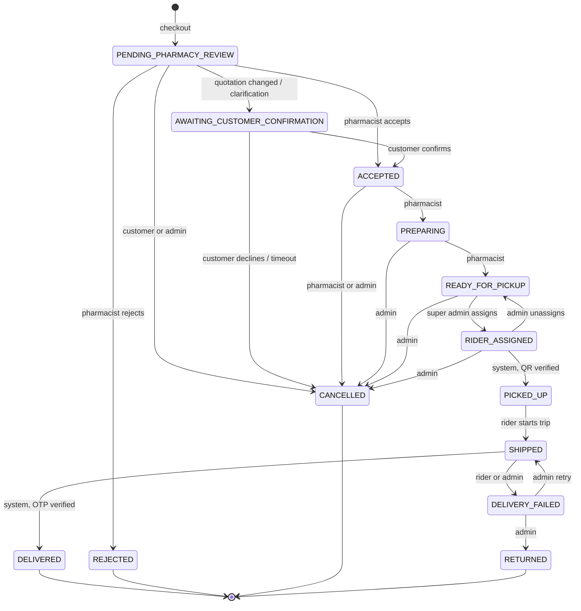
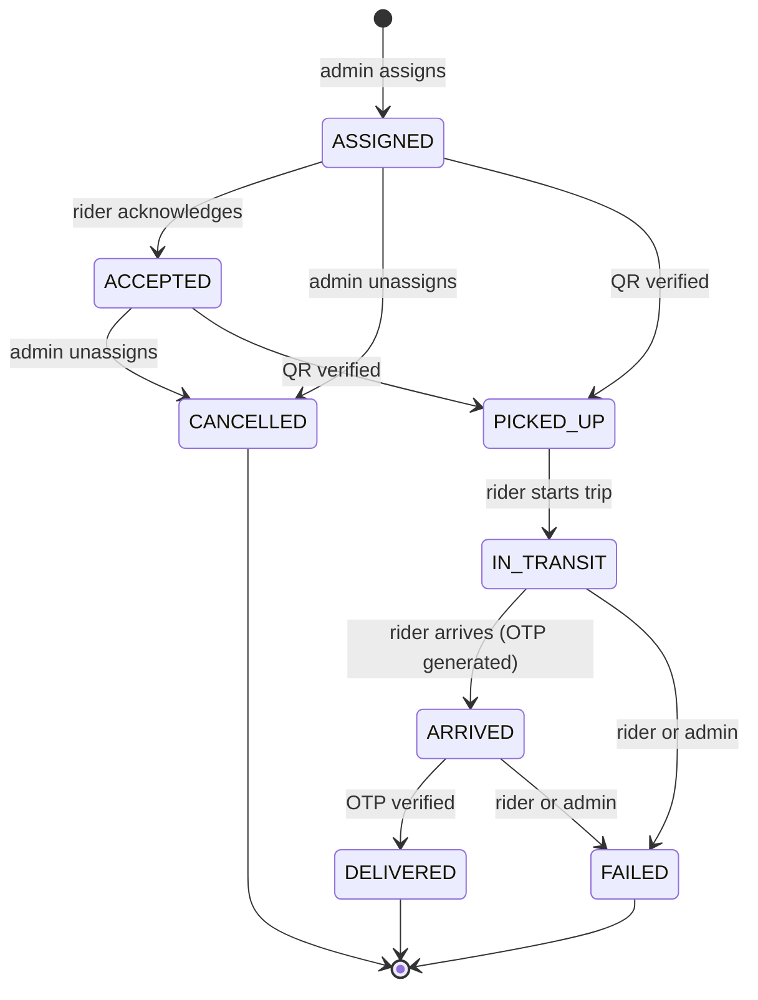

# State Machines (Phase 3 draft)

All transitions are enforced by one central transition table per entity inside the service layer. Any transition not listed is rejected. Every transition runs inside a DB transaction, uses a conditional update (`WHERE status = <expected>`), writes a status-history row, and emits an outbox event.

## 1. Order



| From | To | Actor | Guard |
|---|---|---|---|
| PENDING_PHARMACY_REVIEW | ACCEPTED | Pharmacist of that pharmacy | All `requiresPrescription` items have a verified prescription |
| PENDING_PHARMACY_REVIEW | REJECTED | Pharmacist | Reason required; stock reservation released; coupon and coins refunded |
| PENDING_PHARMACY_REVIEW | AWAITING_CUSTOMER_CONFIRMATION | Pharmacist | Updated quotation stored; customer notified |
| AWAITING_CUSTOMER_CONFIRMATION | ACCEPTED | Patient (owner) | Within confirmation window |
| ACCEPTED | PREPARING | Pharmacist | Stock still reservable |
| PREPARING | READY_FOR_PICKUP | Pharmacist | |
| READY_FOR_PICKUP | RIDER_ASSIGNED | Super Admin | No active delivery; rider active and KYC approved |
| RIDER_ASSIGNED | PICKED_UP | System | Valid single-use QR scanned by the assigned rider |
| PICKED_UP | SHIPPED | Assigned rider | |
| SHIPPED | DELIVERED | System | Valid OTP submitted by the assigned rider |
| SHIPPED | DELIVERY_FAILED | Rider / Super Admin | Reason required |

Cancellation policy (PROPOSED, needs your confirmation): customer may cancel until the pharmacist starts PREPARING; Super Admin may cancel any time before PICKED_UP; stock, coupon and coins are returned on every cancel/reject.

Stock timing (PROPOSED): reserve at checkout; deduct (reserved -> sold) when the order is marked PICKED_UP; release on reject/cancel.

## 2. Delivery



Mapping between delivery and order status:

| Delivery | Order |
|---|---|
| ASSIGNED / ACCEPTED | RIDER_ASSIGNED |
| PICKED_UP | PICKED_UP |
| IN_TRANSIT / ARRIVED | SHIPPED |
| DELIVERED | DELIVERED |
| FAILED | DELIVERY_FAILED |
| CANCELLED | READY_FOR_PICKUP |

`ARRIVED` triggers OTP generation and the customer notification. A retry after FAILED creates a new `Delivery`-level history entry on the same row (the row is reset to ASSIGNED/IN_TRANSIT by Super Admin action); `deliveries.orderId` stays unique.

## 3. Delivery OTP
`ACTIVE -> VERIFIED` (correct code), `ACTIVE -> LOCKED` (attempts exhausted), `ACTIVE -> EXPIRED` (time), `ACTIVE -> SUPERSEDED` (regenerated). Only one ACTIVE OTP per delivery (partial unique index).

## 4. Pickup QR
`ACTIVE -> USED` (single atomic conditional update), `ACTIVE -> EXPIRED`, `ACTIVE -> REVOKED` (admin/reassignment). One QR per (batch, pharmacy).

## 5. Prescription
```
SUBMITTED -> CLINIC_REVIEW (clinic selected) -> FORWARDED_TO_PHARMACY
SUBMITTED -> PHARMACY_VERIFYING (no clinic: Primary Pharmacy)
FORWARDED_TO_PHARMACY -> PHARMACY_VERIFYING
PHARMACY_VERIFYING -> AWAITING_CUSTOMER_CONFIRMATION -> VERIFIED
PHARMACY_VERIFYING -> VERIFIED | REJECTED
any non-final -> CANCELLED (patient) | EXPIRED (system)
```
Open question for the clinic path: after clinic review, does the Super Admin choose the pharmacy (your Workflow 3 lists "Super Admin" between Clinic Review and Pharmacy Verification), or does the system forward to the clinic's own pharmacy / the Primary Pharmacy automatically? The schema supports both.

## 6. Appointment
`BOOKED -> CHECKED_IN -> IN_CONSULTATION -> COMPLETED`; `BOOKED|CHECKED_IN -> CANCELLED`; `BOOKED|CHECKED_IN -> NO_SHOW`. Cancel/no-show frees one slot seat (decrement `bookedCount`) in a locked transaction.

## 7. Withdrawal
`REQUESTED -> APPROVED -> PAID`; `REQUESTED -> REJECTED`; `REQUESTED -> CANCELLED` (by requester). Request places a HOLD; reject/cancel RELEASEs; payout CAPTURES the hold.

## 8. Cash collection
`COLLECTED -> DEPOSIT_PENDING -> DEPOSITED -> VERIFIED`; any step -> `DISCREPANCY` (amount mismatch, flagged for Super Admin).
